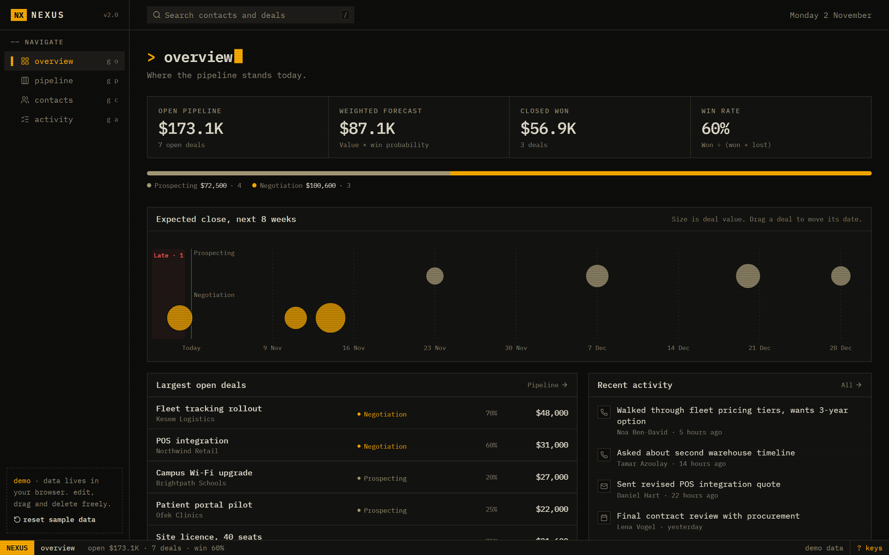
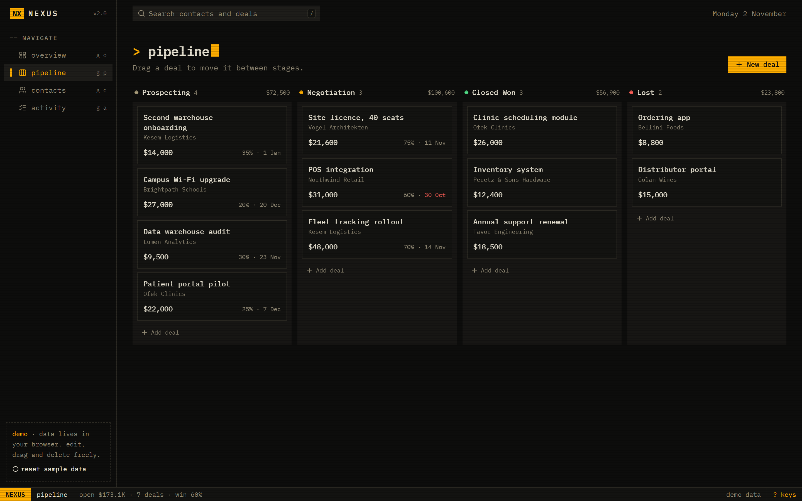
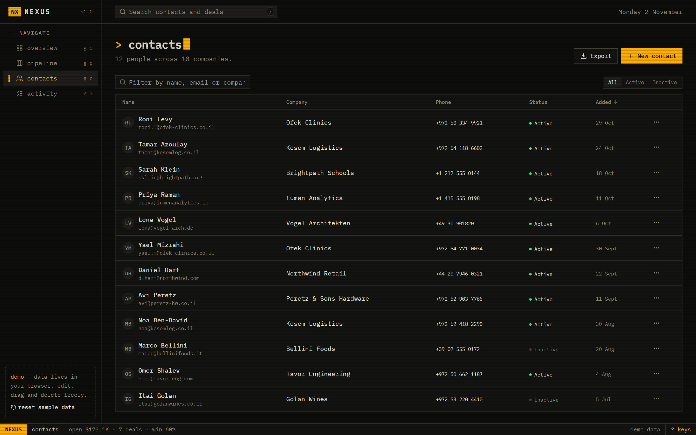

# Nexus CRM

A small sales CRM built to feel like a trading terminal: amber on black, monospaced, driven from the keyboard. A drag-and-drop deal pipeline, a timeline of expected close dates, contacts and an activity log, with a React client and an Express + MongoDB API.

**Live demo:** https://amit-crm.vercel.app — runs on sample data stored in your browser, so you can edit, drag and delete freely. "Reset sample data" in the sidebar puts it back.



| Pipeline | Contacts |
| --- | --- |
|  |  |

## What it does

- **Pipeline board.** Four stages (Prospecting, Negotiation, Closed Won, Lost). Dragging a card moves the deal immediately and syncs in the background; if the save fails, the card goes back. Works with mouse, touch (long-press) and keyboard.
- **Deal timeline.** Every open deal on its expected close date, sized by value and coloured by stage; late deals collect on the left. Drag a deal (or focus it and use the arrow keys) to move its date.
- **Overview.** Open pipeline, a forecast weighted by each deal's win probability, win rate, the largest open deals, and deals that are past their expected close date.
- **Contacts.** Sortable, filterable table with CSV export (UTF-8 with BOM, so Hebrew and other non-Latin names open correctly in Excel).
- **Activity log.** Calls, meetings, emails and notes linked to a contact, grouped by day.
- **Keyboard first.** <kbd>/</kbd> searches, <kbd>g</kbd> then <kbd>o</kbd> / <kbd>p</kbd> / <kbd>c</kbd> / <kbd>a</kbd> jumps between screens, <kbd>?</kbd> lists every shortcut. A status line at the bottom keeps the pipeline totals in view.

## Stack

| | |
| --- | --- |
| Client | React 19, TypeScript, Vite, TanStack Query, TanStack Table, dnd-kit, React Hook Form + Zod, Tailwind CSS |
| Server | Node.js, Express, Mongoose (MongoDB), Zod validation, Helmet |
| Tooling | Vitest, ESLint, GitHub Actions (tests, build and type-check on every push) |

## How it's put together

```
client/
  src/lib/api.ts       one interface, two implementations: HTTP or in-browser demo
  src/lib/demo.ts      demo data source backed by localStorage
  src/lib/metrics.ts   pipeline math (pure functions, unit-tested)
  src/pages/           Overview, Pipeline, Contacts, Activity
server/
  src/models/          Mongoose schemas
  src/routes/          REST routes; CRUD handlers come from one generic factory
  src/utils/validation.ts   Zod schemas checked before anything reaches the database
```

A few decisions worth explaining:

- **The demo doesn't need a server.** `api.ts` picks its data source at build time: with `VITE_USE_API=true` and `VITE_API_URL` it talks to Express, otherwise it uses `demo.ts`, which has the same shapes. The pages don't know which one they're using, so the hosted demo can't break because a free backend went to sleep.
- **Pipeline numbers live in one place.** `metrics.ts` is plain functions over a list of deals, so the overview, the board and the tests all use the same definitions (for example, win rate is won ÷ (won + lost) and is shown as "n/a", not 0%, when nothing has closed yet).
- **Search input is escaped** before it becomes a MongoDB regex, so typing `(` or `.*` searches for that text instead of breaking or widening the query.

## Running it locally

Requires Node 20+.

```bash
# client only, on demo data
cd client
npm install
npm run dev
```

With the API (needs a MongoDB connection string, local or Atlas):

```bash
cd server
cp .env.example .env      # then set MONGO_URI
npm install
npm run seed              # optional sample data
npm run dev               # http://localhost:5000

cd ../client
printf "VITE_USE_API=true
VITE_API_URL=http://localhost:5000
" > .env.local
npm run dev
```

Tests: `cd client && npm test`

## Not done yet

There is no authentication, so the API is single-user; `owner` and `assignedTo` fields exist in the schema for when it's added. Quotes and invoices have models but no UI.
